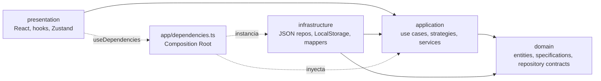
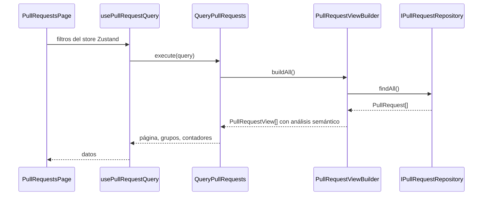

# Git Team Workflow

Aplicación web para administrar equipos de desarrollo y monitorear Pull Requests mediante convenciones semánticas (Conventional Commits). Esta versión trabaja solo con datos simulados.

## Funcionalidades

| Módulo | Contenido |
| --- | --- |
| Dashboard | PR de hoy, abiertos, fusionados, cerrados, pendientes de revisión, cumplimiento semántico, gráficos por día, tipo, equipo y desarrollador, filtro de fechas |
| Equipos | Crear, editar, eliminar, asignar desarrolladores y repositorios, métricas por equipo |
| Desarrolladores | Crear, editar, eliminar, cambiar de equipo, ver actividad individual |
| Repositorios | Crear, editar, eliminar, asociar equipo, ver sus Pull Requests |
| Pull Requests | Lista vertical compacta, filtros combinables, chips de filtros activos, contadores por estado, orden, agrupación expandible, paginación 10/20/50, exportación CSV/JSON, drawer de detalle |
| Análisis semántico | Simulador en tiempo real, tipo, scope, breaking change, motivos y sugerencias, lista de títulos inválidos |
| Code Reviews | Pendientes, aprobadas, cambios solicitados, revisores asignados, tiempos de respuesta |
| Actividad | Línea de tiempo por día derivada de los Pull Requests |
| Reportes | Diario, semanal, mensual, por equipo, desarrollador y repositorio, cumplimiento semántico, exportación CSV/JSON |
| Configuración | Tema claro/oscuro, densidad, avatares, paginación, reglas semánticas, restaurar datos simulados |

## Stack

React 19, TypeScript, Vite, React Router (HashRouter), Zustand (estado de UI y filtros), Recharts, Lucide React, React Hook Form + Zod, CSS con variables (tema claro/oscuro), LocalStorage, Vitest, React Testing Library, ESLint, Prettier.

No se usa Tailwind: el proyecto original ya tenía su propio CSS y se conservó el estilo, migrado a variables CSS.

## Instalación y ejecución

```bash
npm install
npm run dev          # servidor de desarrollo
npm run lint         # ESLint
npm run typecheck    # TypeScript
npm run test         # Vitest (incluye reglas de arquitectura)
npm run build        # typecheck + build de producción en dist/
npm run preview      # sirve dist/
npm run format       # Prettier
```

## Arquitectura

Clean Architecture con la regla de dependencia apuntando hacia el dominio.





### Estructura

```text
src/
├── app/            Composition Root (dependencies.ts), router, provider de dependencias, seeds
├── domain/         entities, enums, value-objects, specifications, repositories (contratos), services, errors
├── application/    use-cases, services, strategies (semantic, sort, group, report, export), ports, dto
├── infrastructure/ repositories (JSON), storage (LocalStorage + migración), adapters, factories, mappers
├── presentation/   layouts, components (common, charts, filters, forms), modules, hooks, store
├── data/           JSON simulados (teams, developers, repositories, pullRequests, reviews, settings)
├── shared/         constants, types, utils
├── styles/         global.css
└── tests/          pruebas por capa y reglas de arquitectura
```

Las carpetas `domain/` y `application/` no importan React, Zustand ni Zod. La prueba `src/tests/architecture/dependencies.test.ts` falla si una capa importa otra que no le corresponde, si el dominio o la aplicación usan paquetes de UI, si algo fuera de `infrastructure/` accede a Web Storage o si los componentes instancian repositorios.

## Principios SOLID

- **SRP**: la validación semántica, el filtrado (`FilterSpecificationBuilder`), el orden (`SortStrategy`), la agrupación (`Grouping`), la paginación (`Pagination`), las métricas (`MetricsService`), la exportación (`ExportStrategy`) y la persistencia (`JsonCollection`) son piezas separadas. Cada caso de uso hace una sola operación.
- **OCP**: un nuevo orden, agrupación, reporte, formato de exportación o regla semántica se agrega como una nueva entrada o clase en su registro, sin modificar los casos de uso.
- **LSP**: `JsonTeamRepository` y una implementación en memoria pasan la misma prueba de contrato (`storage-repositories.test.ts`).
- **ISP**: contratos pequeños por entidad (`ITeamRepository`, `IPullRequestRepository` es de solo lectura, `IReviewRepository`, `ISettingsRepository`) y puertos de una sola operación (`IClock`, `IFileDownloader`, `IDataResetter`).
- **DIP**: los casos de uso reciben interfaces por constructor. `app/dependencies.ts` es el único lugar que crea clases concretas.

## Patrones de diseño y motivo

| Patrón | Dónde | Motivo |
| --- | --- | --- |
| Repository | `domain/repositories`, `infrastructure/repositories` | Cambiar JSON por la API de GitHub sin tocar casos de uso. Los métodos devuelven `Promise` para admitir E/S real. |
| Adapter | `LocalStorageAdapter`, `BrowserFileDownloader`, `SystemClock` | Aislar el navegador detrás de puertos. Facilita las pruebas. |
| Strategy | `SemanticValidationStrategy`, `SortStrategy`, `GroupStrategy`, `ReportStrategy`, `ExportStrategy` | Variantes intercambiables (por ejemplo validación con IA o exportar a otro formato). |
| Specification | `domain/specifications` | Filtros de Pull Requests combinables con `and`, `or` y `not`, testeables sin React. |
| Factory | `createRepositories` | Elegir la fuente de datos en un solo punto (hoy `json`). |
| Mapper | `JsonMappers` (valida con Zod) | Convertir JSON externo en entidades; un futuro mapper de GitHub tendría el mismo rol. |
| Observer | `InMemoryEventBus` | Los casos de uso publican `data-changed` y las vistas se refrescan. Las notificaciones usan el mismo bus. |
| Dependency Injection | Constructores + `DependenciesProvider` | Sin singletons globales ni `new` en componentes. |
| Custom Hook | `useAsyncData`, `usePullRequestQuery`, `useSettings`, `useCatalog` | Separar la lógica de la presentación. |

Zustand se usa solo para estado de interfaz (filtros, orden, página, menú lateral, drawer). Los datos de negocio no están en el store.

## Datos simulados

`src/data/*.json` es la fuente inicial: 5 equipos, 20 desarrolladores, 10 repositorios, 200 Pull Requests (estados, tipos semánticos, títulos válidos e inválidos, revisión y pipeline variados), 184 revisiones y la configuración por defecto. Los JSON se validan con Zod al leerlos.

- Los datos se copian a LocalStorage en el primer uso y desde entonces se leen de ahí. No se regeneran en cada recarga.
- Las fechas de los Pull Requests se calculan una vez, relativas al primer inicio (`dayOffset`). «Restaurar datos simulados» en Configuración las recalcula respecto a hoy.
- Las claves de LocalStorage tienen el prefijo `gtw-`. Los datos guardados por la versión anterior (`devs`, `repos`, `prs`, `theme`) se migran automáticamente (`LegacyStorageMigration`).

## Limitaciones

- No hay conexión con GitHub, autenticación ni backend. No se piden tokens.
- El análisis semántico valida el formato del título, no el contenido del código.
- Actividad es una línea de tiempo derivada del estado actual de cada Pull Request, no de eventos reales. No hay creación de Pull Requests desde la interfaz.
- Las revisiones son datos simulados con tiempo de respuesta en horas.
- Las fechas se vuelven antiguas con el paso de los días hasta restaurar los datos simulados.
- La agrupación se aplica a la página visible.

## Preparación para GitHub

Para conectar GitHub se implementarían `IPullRequestRepository`, `IGitRepository`, `IReviewRepository` y `IDeveloperRepository` sobre REST o GraphQL, con un mapper que convierta las respuestas en las entidades de `domain/`, y se agregaría el caso `github` a `createRepositories`. Los tokens y OAuth deben vivir en un backend (Node o Spring Boot), nunca en el frontend. Los webhooks y las notificaciones en tiempo real pueden publicar en `IEventBus`. Una validación con IA sería otra `SemanticValidationStrategy`. Una base PostgreSQL sería otra implementación de los mismos repositorios detrás de ese backend.

## Decisiones arquitectónicas

1. **Repositorios asíncronos** aunque hoy sean síncronos: evita cambiar todos los casos de uso al pasar a una API.
2. **`PullRequestView`** (PR con autor, repositorio, equipo y análisis semántico resueltos) como unidad de filtrado, orden y agrupación, para que las especificaciones no consulten repositorios.
3. **Pertenencia a equipo por repositorio**: el equipo de un PR es el equipo de su repositorio.
4. **Asignación a equipos**: el formulario de equipo mueve desarrolladores y repositorios desde otros equipos. Para sacar a alguien de un equipo se lo asigna a otro.
5. **Integridad referencial**: no se eliminan equipos con miembros o repositorios, ni desarrolladores o repositorios con Pull Requests.
6. **HashRouter** para funcionar en cualquier hosting estático.
